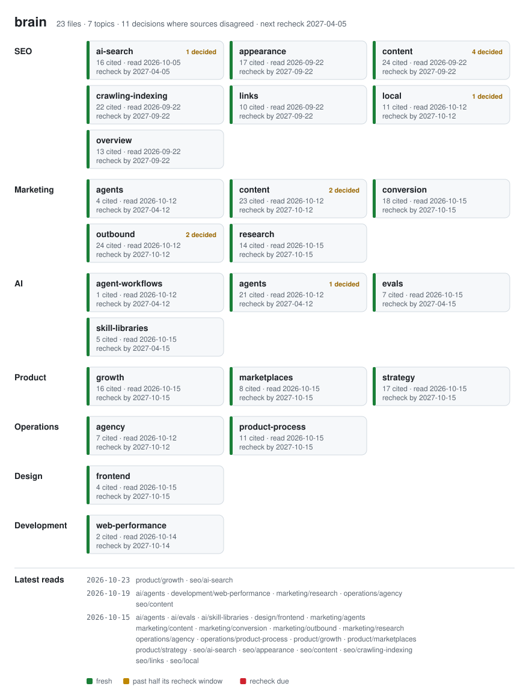

# brain

My go-to knowledge base. Each file distills articles, docs and guides I found
worth keeping into rules I can act on — the files I open (or hand to an agent)
when starting a new project.



*Generated by `python3 build.py` from the files themselves — never edit
`brain-map.svg` by hand. Colour shows how old a file's oldest source is
against its recheck window (a year by default; files can say six months).
Badges count the decisions a file records where sources disagreed.*

## Index

| Topic | File | What it covers |
|---|---|---|
| SEO | [seo/overview.md](seo/overview.md) | Start here: ground truth, eligibility, spam policies, page experience, what to skip, monitoring, pre-ship checklist |
| SEO | [seo/crawling-indexing.md](seo/crawling-indexing.md) | robots.txt, `noindex`, sitemaps, canonicals and pagination, redirects and migrations, JavaScript sites, URLs, international sites |
| SEO | [seo/content.md](seo/content.md) | Helpful content, E-E-A-T, AI content, keyword research and choosing pages (comparison, programmatic), ads and interstitials, images |
| SEO | [seo/links.md](seo/links.md) | Writing links and earning them without link spam |
| SEO | [seo/appearance.md](seo/appearance.md) | How pages look in results: titles, snippets, video, structured data (incl. retired features) |
| SEO | [seo/ai-search.md](seo/ai-search.md) | Google's AI features; AI crawler tokens; how assistants pick sources; measuring citations |
| SEO | [seo/local.md](seo/local.md) | Local businesses: map pack vs results vs AI, profile, reviews, citations, site structure, regulated industries, measuring |
| Marketing | [marketing/content.md](marketing/content.md) | Brand and content: positioning, founder vs brand accounts, copy rules, funnel and pillars, channels, creators, community, testing creative, content team |
| Marketing | [marketing/research.md](marketing/research.md) | Customer interviews, reviews, confidence in findings, competitor research, win-loss |
| Marketing | [marketing/conversion.md](marketing/conversion.md) | Pages, forms and signup, popups, pricing pages, experiments, analytics and attribution |
| Marketing | [marketing/outbound.md](marketing/outbound.md) | Outbound as a system: law baseline, offer, ICP, signals, qualify before enriching, deliverability, the email, replies, weekly tests, first customers |
| Marketing | [marketing/agents.md](marketing/agents.md) | Marketing agents: context additions, campaign measurement, which agents in what order, weekly loop |
| Product | [product/strategy.md](product/strategy.md) | Validating ideas, product-market fit, retention benchmarks, pricing, north star |
| Product | [product/growth.md](product/growth.md) | Activation, onboarding, upgrade prompts, lifecycle email and WhatsApp, cancellation and dunning, referrals |
| Product | [product/marketplaces.md](product/marketplaces.md) | Two-sided products: which side first, launch, fill rate and other metrics, take rates, leakage and trust |
| Design | [design/frontend.md](design/frontend.md) | Public pages that look decided: process, copy on the page, type, colour, layout, imagery, motion, states, AI tells, critique |
| Development | [development/web-performance.md](development/web-performance.md) | Web performance: how to measure, what to check, running it with agents |
| AI | [ai/agents.md](ai/agents.md) | Working with agents: context file, tasks, classifying at volume, automation vs agent, who owns what, autonomy ramp, guardrails, failure modes, coding with agents, writing skills, goals and loops, rollout |
| AI | [ai/evals.md](ai/evals.md) | Evaluating LLM features: error analysis, code checks and model judges, golden sets, shipping AI features |
| AI | [ai/agent-workflows.md](ai/agent-workflows.md) | Multi-agent workflows: graph design, contracts, barriers vs pipelines, verification, convergence, cost |
| AI | [ai/skill-libraries.md](ai/skill-libraries.md) | External skill repos read in full, and which of their skills to load |
| Operations | [operations/agency.md](operations/agency.md) | Running a studio with AI: one folder per client, the ten jobs on real records, audit lens, hiring |
| Operations | [operations/product-process.md](operations/product-process.md) | Specs, scope and time budgets, prototypes, decisions, writing so others can act |
| Checklist | [checklists/new-project.md](checklists/new-project.md) | What to set up when starting a new project: SEO, performance, design, product, measurement, AI features, agents, brand |

## Using the brain from another project

Paste this into a Claude Code session inside the other repository. It
works with the brain as a sibling folder (`../Brain`) or from GitHub.

```
Apply the brain to this project.

The brain is my knowledge base of rules, at ../Brain (or
https://github.com/senblet/Brain). Read its README.md first: the index
table says what each file covers.

1. Work out what this project is from its README, CLAUDE.md/AGENTS.md
   and code: public site or app behind a login, own product or client
   work, marketplace or not, local business or not, does it send email,
   does it contain an LLM feature, do agents publish or edit anything.
2. Pick the brain files that apply to that profile and read each one in
   full. seo/overview.md if it has public pages; design/frontend.md and
   development/web-performance.md for any frontend; marketing/conversion.md
   if people sign up or pay; product/ for our own products;
   product/marketplaces.md for two-sided ones; ai/evals.md if a model
   answers users; ai/agents.md if agents do work here; marketing/outbound.md
   if it sends cold email; seo/local.md for a local business.
3. Audit the project against those files. For every MUST and DON'T,
   check whether the project complies and say where. For SHOULD, judge
   whether it is worth doing here.
4. Produce a short plan: what to change, in which files, ordered by
   impact. Do not start changing anything yet; wait for my go.
5. When I say go: implement the plan in small commits, one concern per
   commit, naming the brain file the rule came from in each commit
   message. Follow this project's own CLAUDE.md where the two disagree
   and tell me where that happened. If the project has public pages,
   copy the brain's seo/ folder into docs/seo/ and reference overview.md
   from CLAUDE.md, as that folder's intro says.
6. Add the applicable items from Brain/checklists/new-project.md to this
   project's own checklist or CLAUDE.md, ticked or not, so the next
   person sees what was done and what was skipped.
7. Finish with a list of brain rules you deliberately did not apply and
   why. If a rule turned out to be wrong for a real project, say so
   plainly: that is feedback for the brain, not for the project.
```

The brain's rules are generic; the project's own `CLAUDE.md` wins on
anything project-specific. Lessons that come back from step 7 go into the
brain through the usual ingest steps.

## Structure

```
brain/
├── README.md              ← this index
├── CLAUDE.md              ← how new articles get folded in
├── build.py               ← regenerates brain-map.svg (standard library only)
├── brain-map.svg          ← generated; shown above
├── <topic>/               ← one folder per domain (seo, marketing, product, design, development, ai, operations…)
│   └── <subtopic>.md      ← split a topic only when one file gets too long
└── checklists/
    └── new-project.md     ← the "starting something" file
```

## How notes are written

- **Merged, not appended.** A new article updates the existing file: new points
  are added where they belong, superseded points are removed. No file is a
  stack of article summaries.
- **Contradictions are decided, not flagged.** When sources disagree, the
  brain picks one — documentation over practitioners, data over opinion,
  the studio's own results over both — and keeps a one-line `**Decided:**`
  note saying what was rejected and why. No file carries an open conflict.
- **One home per rule.** A rule is written once, in the most general file it
  applies to, and linked from the others. General agent practice lives in
  `ai/agents.md`; domain files add only what is specific to them. The `seo/`
  folder is the exception: it is copied into projects, so it stays
  self-contained and never links outside itself.
- **Tagged by strength:**

  | Tag | Meaning |
  |---|---|
  | **MUST** | Required, or breaks things if ignored |
  | **SHOULD** | Best practice with a real effect |
  | **DON'T** | Actively harmful |
  | **Skip** | Effort that isn't worth it |

- **Documentation first, practice second.** Rules from the platform's own
  documentation are the default. Practitioner methods are kept where they
  operationalise those rules, and are marked *(practitioner)* or placed in a
  section that says so, with the source's commercial interest noted. Their
  numbers are reported as theirs, never promoted to rules.
- **Sourced and dated.** Every file ends with a Sources list, with the date
  each source was read, and says when to recheck it: after a year by
  default, six months for fast-moving AI tooling.
- **Checklists follow the topics.** When a topic file changes, the matching
  section of `checklists/new-project.md` is updated too.
